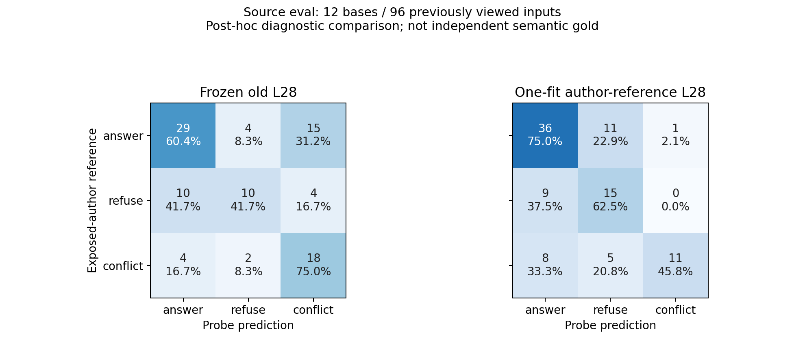

# 2026-10-21：作者参照下的一次L28缓存重训及旧新对照

状态：one_fit_exploratory_author_reference_comparison_complete / history_exposed / independent_gold=false。

用户在上一条已说明“作者侧语义参照、CPU缓存复用、固定L28/48条/最多一次、消耗原预算、eval已查看且只作事后探索”的建议后回复“你直接开始”。本轮将其解释为执行该探索性修订、核验和一次拟合的授权，并在实际拟合前再次明示范围；解释记录在[新修订](../../prompts/semantic_transfer_exploratory_retrain_v1.json)，未伪称用户批准了独立金标准。原正式协议、作者验收标志、审核门禁和全null批准标签均未改。

本轮已完成一次CPU线性探针拟合、240条离线读出、旧新对照、整底题bootstrap及独立实现复算。训练用12个训练底题A表达48条；没有新的模型前向、自由回答或行为评分。**原冻结设计的一次拟合预算现已用完，剩余0；失败、分析报错或更换目录均不恢复预算。**

## 结果与研究判断

新探针对同底题B表达迁移较好，但跨底题的总体增益仍不稳定，冲突参照类召回明显下降。因此当前不能将新probe称为已经可靠的真实证据语义测量，也不据此进入因果干预。

以下一致率/宏F1均针对有历史暴露的作者输入参照，分别报告各切片；不是独立语义准确率。source_eval表示未参与本次拟合的底题来源，原96输出及全部作者判断此前已查看，不能称新的盲测或前瞻确认。

| 切片 | 输入 / 确定作者参照 | 旧probe一致率 | 新probe一致率 | 旧→新诊断宏F1 |
| --- | --- | --- | --- | --- |
| 训练底题A，实际拟合样本 | 48 / 48 | 19/48=39.58% | 48/48=100.00% | 37.17%→100.00% |
| 同训练底题B，未拟合表达 | 48 / 48 | 23/48=47.92% | 41/48=85.42% | 43.65%→85.14% |
| 开发来源，6底题 | 48 / 44 | 18/44=40.91% | 30/44=68.18% | 38.18%→68.04% |
| 评估来源，12底题 | 96 / 96 | 57/96=59.38% | 62/96=64.58% | 57.58%→62.31% |
| 评估来源A | 48 / 48 | 27/48=56.25% | 31/48=64.58% | 55.11%→63.04% |
| 评估来源B | 48 / 48 | 30/48=62.50% | 31/48=64.58% | 60.05%→61.57% |

评估来源一致率净增5/96，即+5.21个百分点，按12底题配对10000次bootstrap的95%区间为**−5.21至+16.67个百分点**；宏F1差+4.73个百分点，区间−5.26至+15.88。区间跨0，不支持稳定总体提升结论。同训练底题B的一致率差+37.50个百分点，区间+16.67至+56.25；这是同底题换表达，不能替代跨底题验证。48条A训练上100%仅为拟合内成绩。

全部240输入中236条确定作者参照的一致率为旧117/236、新181/236，但该集合包含48条拟合样本及同底题B，不能用76.69%作为跨底题主结果。开发四条扑克S/K作者归属unknown仍保留，未自动填标签。

## 改善和代价分别报告

在source_eval96条上：

| 诊断量 | 旧probe | 新probe |
| --- | --- | --- |
| S充分参照→conflict读出 | 9/24=37.50% | 1/24=4.17% |
| K充分参照→conflict读出 | 6/24=25.00% | 0/24=0.00% |
| 充分参照类召回 | 29/48=60.42% | 36/48=75.00% |
| 不足参照类召回 | 10/24=41.67% | 15/24=62.50% |
| 冲突参照类召回 | 18/24=75.00% | 11/24=45.83% |
| 充分参照→refuse读出 | 4/48=8.33% | 11/48=22.92% |
| 冲突参照→answer读出 | 4/24=16.67% | 8/24=33.33% |
| 同题A/B类别一致 | 43/48=89.58% | 43/48=89.58% |
| 同题A/B均与作者参照一致 | 26/48=54.17% | 29/48=60.42% |
| 同表达S→I两端均与参照一致 | 3/24=12.50% | 9/24=37.50% |
| 同表达S→C两端均与参照一致 | 9/24=37.50% | 8/24=33.33% |

减少充分输入的冲突读出，伴随更高的充分→不足和冲突漏检；不能只看假冲突下降就称三分类问题已解决。A/B类别一致率没有上升，且一致也可能稳定地错。



图的行是作者侧参照、列为probe读出，单元格列计数及行内比例。[PDF版本](2026-10-21-semantic-transfer-exploratory-retrain-eval-confusion.pdf)可导出。

## 行为关联：已有回答保持原样

本轮只有离线probe变化，原生成没有收到新probe反馈。全部作者判不足60条实质作答仍23/60，全部冲突无消解选边仍37确定+6unknown/60。

按新probe事后筛选，“作者判不足且probe读refuse”的分母从旧16变为新45，回答数从1变为17，即旧1/16、新17/45。全240中含训练样本，因此这里只是描述。source_eval24条不足输入中，同样条件为旧1/10、新3/15；其余不足输入新3/9作答。条件分母和选中的样本组成变化，并未发生任何新的作答行为或拒答干预，不能将条件率变化解释为模型行为变坏或新probe导致回答。

source_eval全部不足作答仍6/24=25.00%，全部冲突无消解选边仍13确定+2unknown/24=54.17%–62.50%；这些完整分母行为结果是独立于probe筛选的原记录。新probe从生成前状态中离线读出，不等于新probe当时在首token前运行，更不能将其称为模型自知。

## 固定训练、缓存与预算

- 固定48条训练ID为semantic_train12底题×A表达×S/K/I/C。作者参照计数24answer/12refuse/12conflict；全部B、开发和评估底题不进入scaler或分类器拟合。保留L28、2048维，缓存FP16取第28层后转FP32。
- StandardScaler与LogisticRegression(C=1, class_weight=balanced, solver=lbfgs, max_iter=2000, random_state=42)均仅拟合这48条。无校准、阈值调整、层扫描、开发重拟合或二次训练。实际分类器87次迭代，无警告、未触及2000上限，拟合函数耗时1.356秒，完成时间北京时间10:59:13.158263；不含前期核验和之后分析。
- 开发来源按既有数值规则计算触发：旧参照宏F1=0.3818<0.75，S/K充分参照conflict读出14/20=70%>20%；44/48作者归属确定。触发仅用于新探索性修订，原独立审核质量门槛仍不满足，不伪造正式通过。没有根据eval结果挑选设置。
- 新运行为runs/qwen2.5-3b-semantic-transfer-exploratory-author-retrain-v1，protocol的task使用旧v5预算保护识别的semantic_transfer_chat_L28_前缀，design_sha256仍为原冻结设计。真实fit_attempt与共享预算声明runs/semantic-transfer-shared-one-fit-budget-v1.json均已记录。另存目录不重置预算，实际调用未改的v5保护已确认会拒绝同设计的第二次拟合。
- 新模型SHA256为1428dd4f6b2641226042a30121535784a38eade0e488be7ba722b9b64370e7b8。模型、训练矩阵哈希、标签、来源、版本、训练ID和唯一attempt均保存；训练模型文件留本地runs。[拟合封存](2026-10-21-semantic-transfer-exploratory-retrain-fit-seal.json)认证字节，不认证语义标签真值。

## 分析接线错误与修复

v1实际run已经完成唯一拟合，然后在汇总配对指标时因新预测未携带input_tokens报KeyError，入口exit1。该字段被冻结指标用于计算配对token差，本次前置测试漏掉了这项端到端契约。原v1脚本、协议、模型、attempt和失败状态均保留，未为修复报告再拟合。

修复另存scripts/semantic_transfer_exploratory_retrain_analysis_v2.py：从原冻结记录复制精确token长度到离线预测，再调用不变旧指标；类别、概率和训练模型没有修改。新分析输出放在runs/qwen2.5-3b-semantic-transfer-exploratory-author-retrain-analysis-v2。v2只提供analyze/verify，没有训练入口；旧新读出时间点分开标记。原锁只阻止拟合后修改，明确注明eval已见，不冒称清洁评估锁。

后续只读核验入口：

```sh
OPENBLAS_NUM_THREADS=1 OMP_NUM_THREADS=1 /large_disk/wf/miniconda3/envs/kba-rag/bin/python -B scripts/semantic_transfer_exploratory_retrain_analysis_v2.py --stage verify
```

不需要再次运行v1拟合命令，分析修复不恢复已消耗预算。

## 验证及交付

- 新11项预算/训练范围/缓存时点/中断测试通过，unittest0.062秒；修复后新增4项回归/真实缓存分析测试通过，2.227秒，含冻结配对指标token契约、ID/长度拒绝及禁止fit的真实已存模型分析。测试中的拟合为临时假分类器，不计作实际研究拟合。旧13/53/120未重跑。
- 实际prepare与独立进程verify-prepared exit0，均未占用拟合预算；v1 run因上述分析错误exit1。拟合已成功，v2 analyze及PYTHONHASHSEED=127独立进程verify均exit0，JSON/240表重放字节一致，新实际拟合总计始终1。
- [另写CPU核验](2026-10-21-semantic-transfer-exploratory-retrain-independent-check.json)检查scaler的48样本计数、均值与方差精确对应训练A，手算标准化/线性logits/softmax的240概率最大误差0；七切片混淆矩阵、source_eval一致率与宏F1差的10000次配对区间独立重建一致。旧probe保存概率的批量重放最大误差3.886e−16；模型和训练矩阵哈希匹配。该核验没有调用fit，不是独立语义评分。
- [901旧路径清单](2026-10-21-semantic-transfer-exploratory-retrain-preserved.json)全部哈希一致，含原run495、旧240评分、配对分析与冻结实现。12项新拟合封存文件在分析修复前后不变；原正式标签和门禁未修改，380保留题未访问。
- [240条旧新明细CSV](2026-10-21-semantic-transfer-exploratory-retrain-cells.csv)、[七切片汇总CSV](2026-10-21-semantic-transfer-exploratory-retrain-summary.csv)、[完整JSON](2026-10-21-semantic-transfer-exploratory-retrain.json)、混淆图PNG/PDF与本记录已保存，交接/设计/执行说明和实验登记同步。

本轮探索性重训对照已完成。它显示本批同底题表达迁移和充分类冲突误报可以改善，但跨底题三分类仍有明显取舍和不确定性；当前结果不支持可靠语义测量已成立或自动进入patching。一次拟合预算已耗尽，后续可报告和复核这些结果，不追加拟合/调层/调参。独立语义确认仍待实际独立证据；未提交推送。
