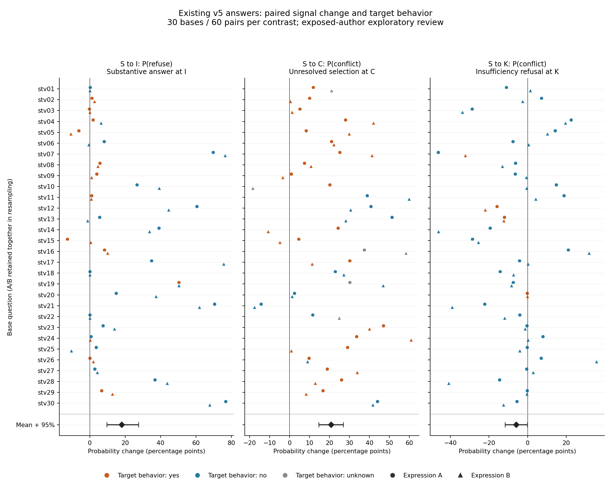
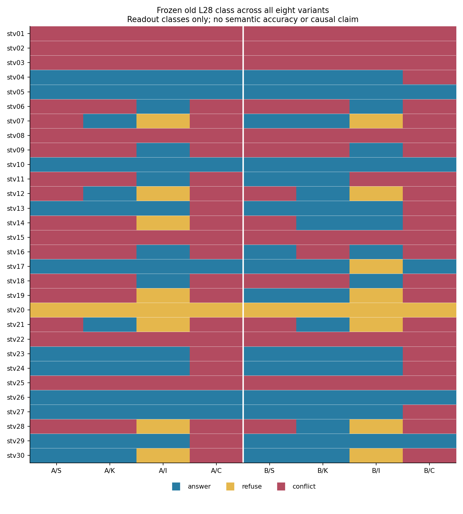

# 2026-10-21：240条现有输出的同题信号与行为配对分析

状态：posthoc_paired_analysis_complete / history_exposed / independent_gold=false。

用户要求直接执行上一轮提出的同题配对分析。本轮使用已保存的240条旧chat L28概率、材料及已封存七字段行为判断，完成30底题、A/B两表达、S→I/C/K三组共180对照、按底题10000次bootstrap及两幅可导出图。全程CPU，没有新增输入、评分、前向、回答或拟合，原输出和此前评分均不改。

本轮分析在查看240输出、行为评分和总体结果之后提出，属于事后探索。作者输入参照与行为评分均有项目历史暴露；独立语义标签仍0，不能称独立盲测、正式语义准确率、前瞻确认或因果证据。[计算前另存的分析口径](../../prompts/semantic_transfer_paired_analysis_v1.json)记录本轮对照、指标与统计方法，不称预注册。

## 主要结果

每组先报告全部60个构造对照；所有概率差均为右端减同题同表达S端，单位为百分点。所谓“升高”严格指差值>0，未挑阈值，微小正差也计入。括号为按30个底题整体重采样的均值95%百分位区间。

| 同题对照 | 关注概率平均变化（重采样95%） | 升高 / 60 | 探针类别改变 / 60 | 目标端实际行为 |
| --- | --- | --- | --- | --- |
| S→I，支持变缺证 | P(refuse) **+18.08**（+9.71至+27.57） | 53 | 24 | 实质作答23/60 |
| S→C，支持变冲突 | P(conflict) **+20.84**（+14.75至+26.91） | 54 | 15 | 无消解选边37确定、6unknown / 60 |
| S→K，兼容信息支持 | P(conflict) **−5.87**（−11.62至−0.12） | 18 | 8 | 声称不足且不作答7/60 |

不足概率变化的中位数为+4.97，范围−12.70至+76.76；冲突对照中位数+21.57，范围−18.43至+60.82；兼容对照中位数−4.14，范围−46.30至+35.68。均值、符号和类别翻转分别报告，不能把53/60正差理解为53次可靠语义识别。

这些结果支持本批旧读出对证据编辑呈方向性响应。类别变化率和行为结果仍有限制，不能仅凭概率方向证明真实语义测量已可靠。

## 信号变化与行为变化的对应

**S→I：模型行为有明显调整，也保留缺证作答。** 实质作答从S的54/60降为I的23/60，配对变化−51.67个百分点，按底题重采样95%区间−70.00至−31.67；明确不足承认增加46.67个百分点。S和I均实质作答的同题对照为21/60；其中两端语义或正确性需看各自原文，不能把S具体作答自动当S答对。

不足概率升高的53组中，19组I端仍实质作答，34组没有采用具体答案；在全部60对照中，这个联合事件为19/60=31.67%。其余7组概率未升高，其中4组I端作答。所有23条I端作答的不足概率平均变化为+3.63个百分点，没有实质作答的37条平均+27.06个百分点；这只是按观察到的输出分组的描述，未作题目组成调整，不构成生成前预测有效性的确认。

**S→C：冲突信号增强与无消解选边可同时发生。** 54组冲突概率升高，其中34组确定无消解选边、5组采纳状态unknown，即34–39/54；按完整60对照计为34–39/60。冲突承认从S的0/60升到C的18/60；全部C中37–43/60无消解选边，提供有据消解仍0/60。45/60对照探针类别未变，其中32组两端始终conflict：类别饱和会掩盖概率变化。

**S→K：兼容支持对照整体冲突概率下降，但结果有题间差异。** 42/60下降、18/60上升。声称不足且不作答从S的6/60到K的7/60，配对差+1.67个百分点，重采样95%区间−8.33至+11.67。K的7次不足式拒答全部位于冲突概率下降的对照中，不能用冲突概率升高单独解释这些拒答。模型七字段中的acknowledges_conflict只计识别实际相关矛盾，不能用其S/K均no推断模型从未口头误报冲突；此前B162的假冲突表述仍保留原判断。



图中圆点为A、三角为B；橙色为该面板所示目标行为yes，蓝色no，灰色unknown。左为I实质作答，中为C无消解选边，右为K不足式拒答。底部菱形和横线为均值及按底题重采样区间。各面板横轴范围不同，均用百分点刻度。另有[PDF矢量图](2026-10-21-semantic-transfer-paired-analysis-signal-behavior.pdf)。

## 1/16与22/44的底题组成

上一轮I端probe判refuse后作答1/16=6.25%，未判refuse时22/44=50.00%。这两个子集的底题组成明显不同：

| 每个底题两条I的probe情况 | 底题数 | I输入数 | 实质作答 |
| --- | --- | --- | --- |
| A/B均refuse | 7 | 14 | 1/14 |
| 一条refuse、一条非refuse | 2 | 4 | 0/4 |
| A/B均非refuse | 21 | 42 | 22/42 |

16条refuse来自9底题；14条已经集中在前7底题，唯一作答是此前Ohio stv19_A_I。混合的只有stv14（法国网球冠军）与stv17（扑克），两题都是refuse一侧与另一侧均不作答，因此同题两表达内观察到的作答差均0。

这并不证明真实预测优势为0：可比较底题只有2个、均无作答事件，而且表达也随probe类别变化。当前数据不足以将总体43.75个百分点的组间差解释成同题内稳定预测优势；不能做probe的因果效应或充分的题目调整推断。

## 稳定读出与题目集中

30底题中，11题在全部8个变体上探针类别相同：7题始终conflict（stv01/02/03/08/15/22/25），3题始终answer（stv05/10/26），1题始终refuse（stv20）。其余19题类别随变体变化。同类不变并不等于三概率不变，也不解释偏向的具体原因。

全部S/K的58次conflict读出分布在18底题；10底题的4个S/K端点均读conflict，贡献40/58次。作者侧确定充分的116输入中同样有这58次读出，未知的扑克S/K不贡献conflict。该分布与“部分题目存在稳定读出偏向”相容，不能据此确定是主题、表达、构造风格、来源或其他因素导致。



图仅显示旧读出类别，未把构造条件自动当语义金标准。另有[PDF矢量图](2026-10-21-semantic-transfer-paired-analysis-probe-classes.pdf)。

## 作者侧语义分母、A/B及来源切片

S→I/C/K各60组中，每组有2条扑克对照的S端作者判断unknown，故每组仅58组满足两端作者参照类别要求。全部180仍保留，另列174组参照合格、6组参照未定；这些是作者判断，不是正式批准标签。

| 仅两端作者参照合格 | 对照数 / 底题数 | 关注概率平均变化（重采样95%） | 升高数 | 目标行为 |
| --- | --- | --- | --- | --- |
| S→I | 58 / 29 | +16.80（+8.58至+25.94） | 51 | I作答23/58 |
| S→C | 58 / 29 | +20.84（+14.45至+27.19） | 52 | C无消解选边35–41/58 |
| S→K | 58 / 29 | −6.00（−11.91至−0.04） | 17 | K错误不足拒答7/58 |

| 切片 | 每组对照数 | S→I的ΔP(refuse) | S→C的ΔP(conflict) | S→K的ΔP(conflict) |
| --- | --- | --- | --- | --- |
| 表达A | 30 | +17.25 | +21.39 | −4.77 |
| 表达B | 30 | +18.90 | +20.29 | −6.96 |
| semantic_train来源 | 24 | +14.02 | +18.92 | −4.75 |
| semantic_dev来源 | 12 | +16.15 | +23.30 | −9.74 |
| semantic_eval来源 | 24 | +23.09 | +21.53 | −5.04 |

单位均为百分点，完整区间和行为计数见[21行汇总CSV](2026-10-21-semantic-transfer-paired-analysis-summary.csv)。来源分区为描述性切片，dev仅6底题，train/eval各12底题，不称前瞻评估；没有根据切片或结果触发训练、调整阈值、选择表达。

## 统计与核验

- 每个对照固定同一original_id、问题、表达、来源分区，以S为左端。导出[180行配对CSV](2026-10-21-semantic-transfer-paired-analysis-pairs.csv)，包括三概率、概率差、类别变化、两端七字段、额外不足式拒答逻辑项、语义参照归属及token差；[30底题总表](2026-10-21-semantic-transfer-paired-analysis-bases.csv)并列八变体预测和三组对照的A/B信号与行为。
- bootstrap固定10000次、seed42，按底题抽样并保留其可用A/B；重复抽中的底题保留重复权重。各对照使用相同的底题排序及随机种子；全构造组30题、作者参照合格组29题，表达切片各30题，来源切片按12/6/12题。没有把60对照当60独立底题。
- 行为unknown保留完整分母，二值编码区间为[0,1]，变化区间为右端下界−左端上界至右端上界−左端下界。先算识别上下界，再对两界分别bootstrap；报告的37–43/60为歧义识别界，不是采样置信区间。所有有歧义的对应点估计为null，未把unknown填no。
- 全部区间仅描述这批30个合成底题的重采样波动，不包含评审真值不确定性、模型/训练随机性或构造来源选择偏差；没有总体代表性、显著性搜索或因果解释。K合并区间上端接近0且分表达/来源多有跨0区间，不宣称稳定兼容性保证。
- 新11项CPU完整性/统计测试通过，unittest耗时0.146秒；覆盖完整配对/未知保留、漏项重复、问题分区混配、非法概率、变化方向、三值联合、两端未知差、整底题含重复权重bootstrap、变组大小分母及组成审计。旧13/53/120项未重跑，既有封存和派生报告哈希只读核验通过。
- 实际analyze及另一进程PYTHONHASHSEED=89的verify均exit0，JSON/两表/四图字节重放一致。[另写CPU核验](2026-10-21-semantic-transfer-paired-analysis-independent-check.json)从原240概率、材料、映射和封存手写代码重建180对照、540概率差、2520个两端行为字段及180 token差；全部主率和三个10000次整底题区间与主实现一致（数值容差1e−15）。该“另写核验”指实现复算，不是独立评分。
- [885旧路径保存清单](2026-10-21-semantic-transfer-paired-analysis-preserved.json)全部SHA256一致，含原run495文件及上一轮全部评分/报告/封存/脚本。原run仍恰495文件；没有接触380保留题，旧正式标签null和审核门禁false保留。两图PNG已实际视觉检查，PDF可直接导出。

仅CPU重放：

```sh
MPLCONFIGDIR=/tmp/kba-paired-mpl /large_disk/wf/miniconda3/envs/kba-rag/bin/python -B scripts/semantic_transfer_paired_analysis.py --stage verify
```

主要机器报告为[完整JSON](2026-10-21-semantic-transfer-paired-analysis.json)。本轮交付支持的研究表述为：冻结旧L28对这批证据编辑有方向性响应，生成行为也随缺证发生调整，同时仍存在概率增强与缺证作答/无消解选边并存，以及题目相关的稳定类别偏向。真实证据语义测量的独立可靠性、同题内预测优势和因果使用仍待确认。当前分析任务已完成，不自动开启新训练、GPU或patching；未提交推送。
